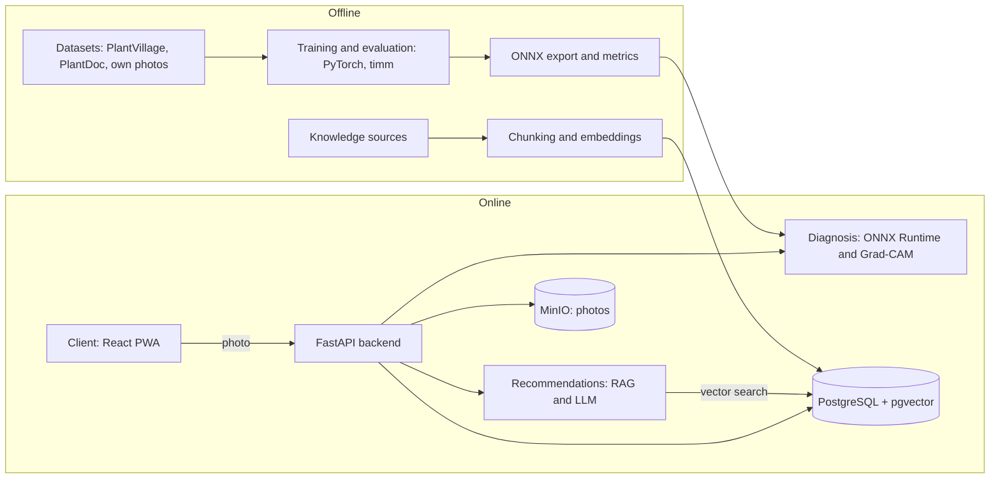

# Plant Disease AI

AI-Powered Plant Disease Detection and Treatment Recommendation System. Diploma project.

The user takes a photo of a plant leaf. The system names the most likely disease, shows how confident it is and where on the leaf it looked, and then gives treatment and prevention advice with links to the sources.

## Table of contents

1. [Overview](#overview)
2. [Problem, users, expected outcomes](#problem-users-expected-outcomes)
3. [Scope](#scope)
4. [Technology stack](#technology-stack)
5. [How AI is used](#how-ai-is-used)
6. [Architecture](#architecture)
7. [Repository structure](#repository-structure)
8. [Getting started](#getting-started)
9. [User guide](#user-guide)
10. [API overview](#api-overview)
11. [Testing and evaluation](#testing-and-evaluation)
12. [Team and responsibilities](#team-and-responsibilities)
13. [Project management](#project-management)
14. [Project status](#project-status)
15. [Data, licences and limitations](#data-licences-and-limitations)


## Overview

Plant Disease AI is a web application. It can be installed as a PWA and works from a phone browser. It helps growers recognise plant diseases from a leaf photo and decide what to do next.

It has two AI parts:

1. **Image classifier.** A convolutional neural network (CNN) trained on the [PlantVillage dataset](https://github.com/spmohanty/plantvillage-dataset) and tested on real field photos. It recognises the crop and the disease.
2. **Recommendation engine.** Retrieval-Augmented Generation (RAG). It searches a knowledge base of agronomic sources and writes advice only from the passages it found, with links to those sources.

Everything else (accounts, storage, history, the web interface) is ordinary software.

## Problem, users, expected outcomes

**Problem.** Plant diseases cause large crop losses, and people without agronomic training find it hard to spot them early. Many existing apps give only a label, do not cite sources for their advice, and use models trained on lab images that work worse on real field photos.

**Target users.** Small farmers, home and greenhouse gardeners, agronomy students and agronomists who need a quick first assessment.

**Expected outcomes.**

- A working prototype of the full path: photo, diagnosis, advice with sources.
- A measured comparison of several image models on lab data and on field data.
- A recommendation module where every piece of advice has a source that can be checked.
- Written requirements, architecture and evaluation results.


## Scope

**In scope (MVP)**

- Upload or capture a leaf photo and classify crop and disease (PlantVillage classes).
- Show the top 3 predictions with confidence and a Grad-CAM heatmap.
- Ask for a new photo when confidence is low or the image is not a leaf.
- Treatment and prevention advice with sources (RAG).
- User accounts and diagnosis history.
- Interface in Russian and English.
- Evaluation on lab and field test sets, and a demo-based usability check with the supervisor.

**Out of scope (future work)**

- Crops and diseases outside the training classes.
- Native mobile apps and offline inference on the device.
- Pest and nutrient-deficiency detection, drone or satellite images.
- Kazakh interface.


## Technology stack


| Layer               | Technology                                                                                            |
| ------------------- | ----------------------------------------------------------------------------------------------------- |
| ML and data         | Python, PyTorch, timm, scikit-learn, Jupyter; Google Colab or Kaggle for GPU                          |
| Experiment tracking | Weights & Biases                                                                                      |
| Model serving       | ONNX, ONNX Runtime                                                                                    |
| Backend             | Python, FastAPI, Pydantic, SQLAlchemy, Alembic                                                        |
| Database            | PostgreSQL with pgvector                                                                              |
| File storage        | MinIO (S3-compatible)                                                                                 |
| Recommendations     | sentence-transformers embeddings (multilingual), pgvector search, LLM via API (provider to be chosen) |
| Frontend            | React, TypeScript, Vite, PWA                                                                          |
| DevOps              | Docker, Docker Compose, GitHub Actions                                                                |
| Testing             | pytest, Vitest, Playwright                                                                            |
| Project management  | Qadam, GitHub (branches and pull requests)                                                            |


## How AI is used


### 1. Disease recognition (computer vision)

- **Models.** Transfer learning from CNNs pretrained on ImageNet. We compare at least three: ResNet50 (baseline), EfficientNet-B0 and MobileNetV3. ViT-Small or ConvNeXt-Tiny are optional.
- **Training data.** PlantVillage: 54,306 images in 38 classes (14 crops, 26 diseases, plus healthy leaves). Train, validation and test sets are split so that photos of the same leaf never end up in different sets. Otherwise the metrics look better than they really are.
- **Real-world check.** A separate field test set (PlantDoc and our own photos) shows how well the model works outside the lab. Only classes that exist in both PlantVillage and the field data are used for this test.
- **Explainability.** Grad-CAM heatmaps show which parts of the leaf influenced the prediction.
- **Unclear input.** If confidence is below a threshold, or the image is not a leaf, the app asks for a better photo instead of guessing.
- **Deployment.** The best model is exported to ONNX and run in the FastAPI backend with ONNX Runtime. A CPU is enough. ONNX Runtime does not give gradients, so the Grad-CAM heatmap is computed with PyTorch for the selected model.


### 2. Treatment recommendations (RAG)

1. **Knowledge base.** Agronomic sources that can be cited: extension guides, review articles, official recommendations. Each document is split into chunks, converted to embeddings and stored in PostgreSQL (pgvector).
2. **Retrieval.** For the diagnosed crop and disease, the system finds the most relevant chunks.
3. **Generation.** An LLM writes the advice using only the retrieved chunks and adds references. If nothing relevant is found, the system says so and does not make up advice.
4. **Baseline.** A simple lookup table (disease to treatment) without an LLM is kept for comparison, so we can show what RAG adds.


### What is not done by AI

Authentication, file storage, history and access control are regular backend code.

## Architecture




**Request flow**

1. The client sends a photo to `POST /diagnose`. The backend saves the image in MinIO.
2. The diagnosis module returns the top 3 classes, the confidence and a heatmap, or a "retake photo" answer.
3. If the diagnosis is accepted, the client calls `POST /recommend` with the crop and disease. The recommendation module finds passages in the knowledge base and generates an answer with sources.
4. Both results are saved in the user's history.


## Repository structure

```text
plant-disease-ai/
├── README.md
├── .gitignore
├── .env.example            # placeholders only, never real secrets
├── docker-compose.yml
├── docs/                   # proposal, literature, comparisons, requirements, ADRs
│   └── adr/
├── diagrams/               # editable sources (.drawio / .puml) and png/svg exports
├── ml/                     # notebooks, training, evaluation, ONNX export
├── backend/                # FastAPI: api, services (diagnosis, recommend), db
├── frontend/               # React + TypeScript PWA
├── knowledge-base/         # source list and indexing scripts for RAG
├── tests/
└── .github/
    ├── workflows/ci.yml
    └── pull_request_template.md
```

Large files (datasets, model weights) are not committed. Download instructions will be in `ml/README.md`. Trained weights are published through GitHub Releases or external storage.

## Getting started

**Requirements:** Git, Docker with Docker Compose, Node.js 20 or newer, Python 3.11 or newer (only for ML work).

**Run the application**

```bash
git clone <repository-url>
cd plant-disease-ai
cp .env.example .env          # then fill in the values
docker compose up --build
```

This starts the backend, PostgreSQL with pgvector and MinIO. The API documentation will be available at `http://localhost:8000/docs`.

**Run the frontend in development mode**

```bash
cd frontend
npm install
npm run dev
```

**Work on the ML part**

```bash
cd ml
pip install -r requirements.txt
```

Load the dataset from Hugging Face (the original PlantVillage repository uses Python 2.7 scripts, so we do not use them):

```python
from datasets import load_dataset
dataset = load_dataset("mohanty/PlantVillage", "color")
```

**Run the tests**

```bash
pytest                         # backend and ML utilities
cd frontend && npm test        # frontend
```


## User guide

*Describes the planned behaviour of the application.*

1. Open the app and register or log in.
2. Press **Scan**. Take a photo of one leaf or upload an existing photo. For the best result, use daylight, keep the leaf in focus and let it fill most of the frame.
3. Read the result: the crop, the most likely disease, the confidence and the heatmap that shows where the model looked. Two alternative diagnoses are shown as well.
4. If the app asks you to retake the photo, the image was unclear or did not show a leaf. Try again with better light.
5. Open **Recommendations** to see treatment and prevention steps. Each item has a link to its source.
6. Earlier diagnoses are in **History**.


## API overview

*Planned. The exact request and response formats will be described in the OpenAPI file in* `backend/`*.*


| Method | Endpoint                                      | Purpose                                        |
| ------ | --------------------------------------------- | ---------------------------------------------- |
| POST   | `/api/v1/auth/register`, `/api/v1/auth/login` | Create an account and log in                   |
| POST   | `/api/v1/diagnose`                            | Upload a photo, get predictions and a heatmap  |
| POST   | `/api/v1/recommend`                           | Get advice with sources for a crop and disease |
| GET    | `/api/v1/history`                             | List the user's previous diagnoses             |
| GET    | `/api/v1/health`                              | Check that the service is running              |


All endpoints except register, login and health require a login token.

## Testing and evaluation

- **Automated tests (planned):** pytest for the backend and ML utilities, Vitest for the frontend, end-to-end scenarios with Playwright. Everything runs in CI on every pull request.
- **Model metrics:** accuracy, macro-F1, recall per class, confusion matrix and calibration (ECE), on the lab test set and on the field set.
- **Recommendation quality:** share of answers with valid citations, faithfulness to the sources (manual review on a fixed set of questions), retrieval hit rate. The baseline is the lookup table without an LLM.
- **Usability check:** scripted demo scenarios (photo, diagnosis, advice) walked through with the supervisor. Problems are logged as tasks.


## Team and responsibilities

**Principle.** The work is not split into "one person does backend, another frontend, a third AI". Each member owns one feature and builds it through all layers: AI and data, backend, frontend, tests. This way everyone works on AI, backend and frontend, and everyone can explain a complete part of the system at the defense. Every pull request is reviewed by another team member, and every module has a deputy.

### Who does what


| Layer          | Shynggys: Diagnosis                                                                                            | Mukhammedali: Recommendations                                                                                                             | Alikhan: Platform and reliability                                                                         |
| -------------- | -------------------------------------------------------------------------------------------------------------- | ----------------------------------------------------------------------------------------------------------------------------------------- | --------------------------------------------------------------------------------------------------------- |
| **AI / data**  | Dataset split without leakage; train and compare ResNet50, EfficientNet-B0, MobileNetV3; Grad-CAM; ONNX export | Knowledge base from cited sources; chunking and embeddings; RAG pipeline with citations; lookup-table baseline; answer-quality evaluation | Field photo test set; rejection of low-confidence and "not a leaf" photos; model evaluation on field data |
| **Backend**    | Inference service; `POST /diagnose`                                                                            | Retrieval and generation service; `POST /recommend`                                                                                       | FastAPI skeleton, PostgreSQL schema, authentication, photo storage (MinIO), `GET /history`, Docker, CI    |
| **Frontend**   | Photo upload screen; result screen with confidence and heatmap                                                 | Recommendations screen with clickable sources and disclaimer; RU/EN texts                                                                 | App shell and routing, PWA setup, login, register and history screens                                     |
| **Tests**      | Model tests, `/diagnose` API tests                                                                             | Retrieval and citation tests, `/recommend` API tests                                                                                      | End-to-end tests, CI pipeline, auth and storage tests                                                     |
| **Documents**  | Thesis chapter "Model and experiments"                                                                         | Thesis chapter "Recommendation module"                                                                                                    | Thesis chapter "Implementation and testing"                                                               |
| **Deputy for** | Recommendations                                                                                                | Platform                                                                                                                                  | Diagnosis                                                                                                 |


### How the parts fit together

The three parts are developed in parallel and connect through agreed API contracts (OpenAPI files in `backend/`), so nobody waits for another person's code.

1. Alikhan builds the platform: users, database, storage, history.
2. Shynggys's `/diagnose` returns the diagnosis (disease and confidence).
3. Mukhammedali's `/recommend` takes that diagnosis and returns advice with sources.
4. Alikhan's history stores both results, and the screens of all three are combined into one app.

Until the real model and the RAG pipeline are ready, each part works against a stub that returns an answer in the agreed format.

### Rotating roles


| Period         | Tech lead (architecture, merges) | Docs and Qadam owner (tasks, README, notes) | QA and CI owner (tests, pipeline, bugs) |
| -------------- | -------------------------------- | ------------------------------------------- | --------------------------------------- |
| Oct - Dec 2026 | Shynggys                         | Mukhammedali                                | Alikhan                                 |
| Jan - Feb 2027 | Mukhammedali                     | Alikhan                                     | Shynggys                                |
| Mar - Apr 2027 | Alikhan                          | Shynggys                                    | Mukhammedali                            |


**Supervisor:** *Kydyrbekova Aigerim Balgabaevna*

## Project management

- **Qadam board:** 
- **Workflow:** one **Qadam** task per piece of work. Create a branch `<TASK-ID>-short-name`, commit with `<TASK-ID>: message`, open a pull request, get a review from another member, merge into `main`.

## Project status


| Stage                                                | Status      |
| ---------------------------------------------------- | ----------- |
| Repository, README, **Qadam** board                  | in progress |
| Analysis: literature, existing systems, requirements | in progress |
| Architecture and prototype mock-ups                  | in progress |
| Baseline model training                              | not started |
| Backend, frontend and RAG implementation             | not started |


*Update this table at every milestone.*

## Data, licences and limitations

- **Datasets:** [PlantVillage](https://github.com/spmohanty/plantvillage-dataset) (images taken in controlled conditions), PlantDoc and our own field photos. Check the licence of each dataset before sharing anything. Datasets are not stored in this repository.
- **Known limitation:** PlantVillage images have uniform backgrounds, so accuracy on real field photos is expected to be lower. This is why the evaluation includes a separate field test set.
- **Advice disclaimer:** the system gives information based on cited sources and can be wrong. It does not replace an agronomist.
- **Privacy:** user photos and accounts are stored only for the history feature. No secrets or personal data are committed to the repository.

